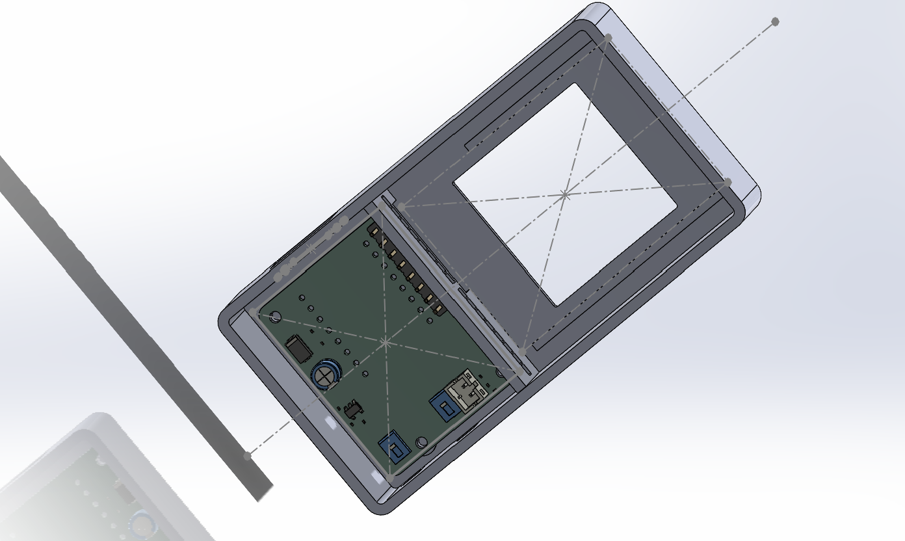
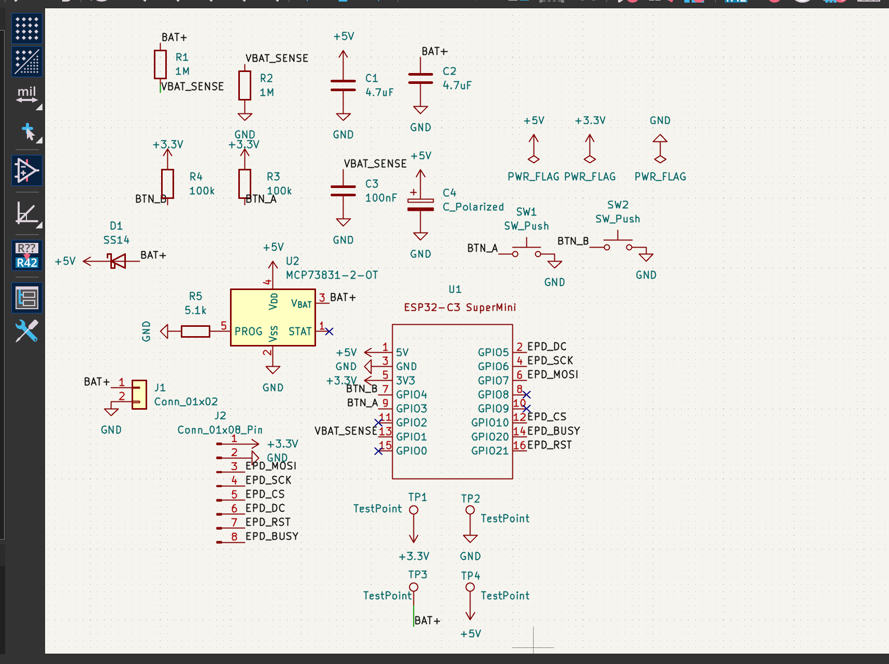
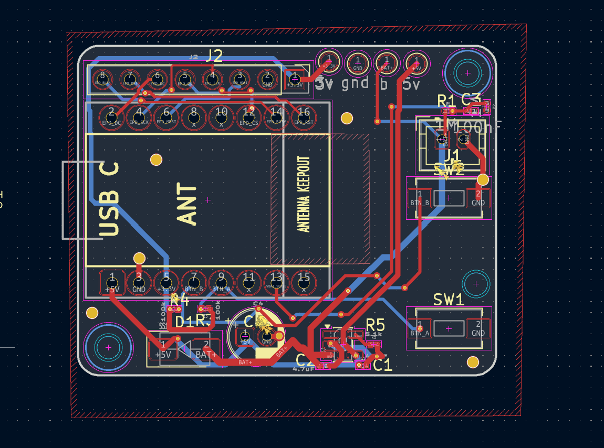
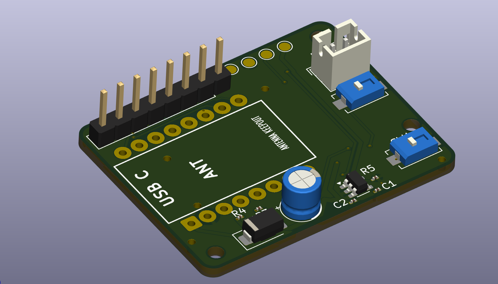
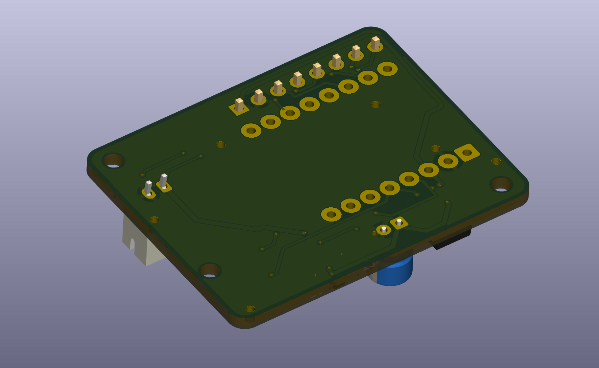

# Dispolays - Week 4 Hardware Build

Dispolays is a compact, battery-powered e-paper device built around an ESP32-C3 SuperMini. During Week 4, I designed the custom carrier PCB in KiCad and started a parametric enclosure in SolidWorks.

This is still a **digital prototype**. I did not have the physical components during Week 4, so the PCB footprints, enclosure clearances, charging circuit, and final assembly still need to be checked with the real parts before manufacturing or connecting a LiPo battery.



## What I completed this week

- Designed the complete schematic in KiCad
- Created a custom ESP32-C3 SuperMini symbol and provisional footprint
- Added an MCP73831 LiPo charging circuit
- Added an SS14 battery power path
- Added battery-voltage sensing
- Routed a two-layer PCB with power and signal net classes
- Added GND pours on both copper layers
- Added test points and an antenna keepout
- Exported Gerbers, drill files, and a PCB STEP model
- Imported the PCB into SolidWorks
- Started a parametric PETG enclosure
- Added the display opening, PCB bosses, separator, J2 clearance, side-button slots, and USB-C access

## System overview

The current design includes:

- ESP32-C3 SuperMini mounted on removable 1x8 socket strips
- 1.54-inch, 200x200 black-and-white e-paper display interface
- MCP73831 single-cell LiPo charger
- SS14 Schottky battery power path
- Battery-voltage measurement circuit
- Two side buttons
- Four electrical test points
- Two-layer custom PCB
- Parametric PETG enclosure model

## Schematic



### Main components

- `U1` - ESP32-C3 SuperMini
- `U2` - MCP73831T-2ACI/OT, SOT-23-5, 4.2 V LiPo charger
- `D1` - SS14 Schottky diode, SMA package
- `J1` - 2-pin JST-PH battery connector
- `J2` - 1x8, 2.54 mm e-paper connection header
- `SW1`, `SW2` - side-actuated buttons
- `R1`, `R2` - 1 MOhm battery-voltage divider
- `R3`, `R4` - 100 kOhm external button pull-ups
- `R5` - 5.1 kOhm charger-programming resistor
- `C1`, `C2` - 4.7 uF charger capacitors
- `C3` - 100 nF battery-sense filter capacitor
- `C4` - 100 uF bulk capacitor
- `TP1` - 3V3
- `TP2` - GND
- `TP3` - BAT+
- `TP4` - 5V

### GPIO assignment

| Function | ESP32-C3 pin |
|---|---:|
| VBAT_SENSE | GPIO1 |
| BTN_A | GPIO3 |
| BTN_B | GPIO4 |
| EPD_DC | GPIO5 |
| EPD_SCK | GPIO6 |
| EPD_MOSI | GPIO7 |
| EPD_CS | GPIO10 |
| EPD_BUSY | GPIO20 |
| EPD_RST | GPIO21 |

The following pins are intentionally unused:

```text
GPIO0
GPIO2
GPIO8
GPIO9
```

### E-paper connector pinout

| J2 pin | Signal |
|---:|---|
| 1 | 3V3 |
| 2 | GND |
| 3 | DIN / EPD_MOSI |
| 4 | CLK / EPD_SCK |
| 5 | CS / EPD_CS |
| 6 | DC / EPD_DC |
| 7 | RST / EPD_RST |
| 8 | BUSY / EPD_BUSY |

## Power design

The MCP73831 charge current is set by `R5 = 5.1 kOhm`, giving a target charge current of approximately `196 mA`.

The battery power path is:

```text
BAT+ -> SS14 anode
SS14 cathode -> 5V rail
```

Battery voltage is measured before the diode:

```text
BAT+ -> R1 1 MOhm -> VBAT_SENSE -> R2 1 MOhm -> GND
                              |
                           C3 100 nF
                              |
                             GND
```

## PCB design



The PCB is approximately `38 x 30 x 1.6 mm`, uses two copper layers, and has three mechanical mounting holes.

### Routing choices

- Signal traces: approximately `0.25 mm`
- Power traces: approximately `0.50 mm`
- GND zones on both `F.Cu` and `B.Cu`
- GND stitching vias between both layers
- Antenna rule area blocking copper zones, tracks, and vias
- Current minimum measured antenna clearance: approximately `7.5 mm`

The design target is at least `8 mm`. Because the PCB is now frozen, the enclosure must keep the battery, display cable, screws, and other conductive objects farther away from the antenna region.

### PCB renders

| Front | Back |
|---|---|
|  |  |

## Enclosure design

The enclosure is being designed parametrically in SolidWorks and is intended to be printed in PETG.

### Current Version 1 envelope

```text
Width:  47.0 mm
Height: 88.0 mm
Depth:  21.5 mm
```

### Current enclosure features

- 2.0 mm side walls
- 1.6 mm front wall
- 2.0 mm rear-panel target
- 29 x 29 mm display window
- Upper display and battery zone
- Lower PCB and electronics zone
- Internal separator rib
- Display-cable slot
- Enlarged J2 connector clearance
- Three PCB mounting bosses aligned to the frozen PCB
- Right-side button slots
- Oversized Version 1 USB-C opening
- External USB cable-housing recess
- Back shell started but not yet finished
- Provisional battery pocket still to be completed

The enclosure is being designed around a Waveshare-style 1.54-inch black-and-white e-paper module:

```text
Driver-board outline: 48 x 33 mm
Resolution:           200 x 200
Active area:          approximately 27.6 x 27.6 mm
Interface:            SPI
```

The display is rotated inside the portrait enclosure so its 33 mm dimension runs across the enclosure width.

### Dimensions still waiting for physical parts

- ESP32-C3 SuperMini outline and pin-row spacing
- Socket height and assembled SuperMini stack height
- USB-C connector centre height
- Display thickness and active-area offset
- Display cable and connector size
- Side-switch actuator dimensions
- LiPo size and connector polarity
- C4 height
- Final battery-pocket dimensions

## Repository structure

```text
cad/
├── Dispolays_Enclosure_Assembly.SLDASM
├── Dispolays_Enclosure_Master_front-shell.SLDPRT
└── Dispolays_kicad.step

hardware/
├── Dispolays_week4.kicad_pro
├── Dispolays_week4.kicad_pcb
├── Dispolays_week4_schematics.kicad_sch
├── Dispolays_week4-PTH.drl
└── Dispolays_week4-NPTH.drl

images/
├── Dispolays_schematics.png
├── Enclosure_3D.png
├── Pcb_Editor.png
├── PCB-3d-front.png
└── PCB-3d-back.png
```

The repository also includes the generated fabrication files. Native SolidWorks files should be collected with **Pack and Go** so the assembly does not lose referenced components when opened on another computer.

## Verification completed

- [x] Custom ESP32-C3 SuperMini schematic symbol created
- [x] Custom provisional SuperMini footprint created
- [x] MCP73831 changed to the five-pin SOT-23 package
- [x] Schematic ERC reviewed
- [x] PCB DRC reviewed
- [x] No unconnected nets reported after zone refill
- [x] GND pours added to both copper layers
- [x] Antenna keepout added
- [x] PCB imported into the SolidWorks enclosure assembly
- [x] Three PCB mounting bosses aligned with the PCB mounting holes
- [x] J2 and separator interference identified and cleared
- [x] Side-button openings added
- [x] USB-C access opening added

## Verification still required

### Before PCB ordering

- [ ] Purchase and measure the real ESP32-C3 SuperMini
- [ ] Print the SuperMini footprint at 1:1 scale and test all 16 pins
- [ ] Confirm the selected 1x8 female sockets fit and measure their height
- [ ] Select switches that exactly match the frozen PCB footprints
- [ ] Confirm that the physical display harness fits J2
- [ ] Verify the J1 battery-connector polarity
- [ ] Select the exact protected single-cell LiPo
- [ ] Select a 100 uF capacitor matching the current footprint
- [ ] Complete the back shell and battery pocket
- [ ] Run final enclosure-to-PCB interference checks
- [ ] Export the final enclosure STEP and STL files
- [ ] Inspect Gerbers and drill files in a Gerber viewer

### Before connecting a LiPo

- [ ] Check for shorts between 5V, 3V3, BAT+, and GND
- [ ] Assemble and test without the SuperMini or battery first
- [ ] Apply current-limited 5 V at TP4
- [ ] Confirm that U2 does not overheat
- [ ] Verify that BAT+ is approximately 4.2 V with no battery connected
- [ ] Confirm battery-plug polarity with a multimeter
- [ ] Measure the initial charge current, targeting approximately 196 mA
- [ ] Verify the SS14 power-path voltage drop

### Firmware and breadboard tests

- [ ] T-00: SuperMini identity, sleep current, and wireless test
- [ ] T-01: E-paper full-refresh test
- [ ] T-02: Partial-refresh and ghosting test
- [ ] T-03: Button wake test
- [ ] T-04: Battery ADC test

## Known limitations

1. No physical components were available during Week 4.
2. The SuperMini footprint is provisional and must be verified before fabrication.
3. The enclosure uses conservative Version 1 dimensions and is not yet ready for final printing.
4. The battery, switches, socket strips, display harness, and C4 package have not been physically verified.
5. The PCB uses three mounting holes instead of four.
6. The PCB STEP model does not yet represent the complete removable SuperMini socket stack.


## Safety

This is a custom prototype that includes a single-cell LiPo charging circuit I could have messed something and boom! beware or something 🙏

## Author

**Sergel Hasabella**  
Week 4 hardware design submission
